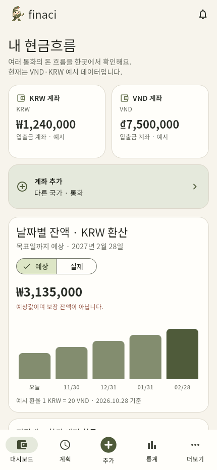
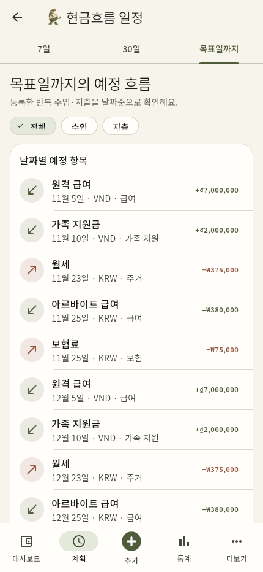
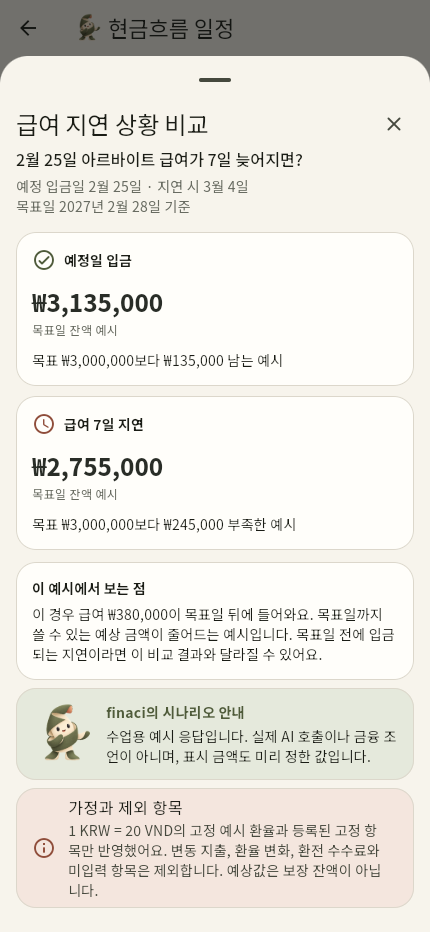
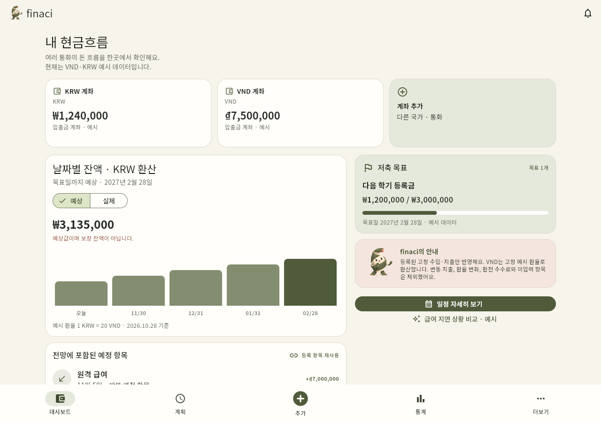

# finaci (피나시) — GAI3008 중간프로젝트

## 앱 소개

### 앱 이름
finaci (피나시)

### 부제
다국가·다중 통화 생활비 계획 도우미

### 카테고리
금융

### 대상 사용자 / 사용 상황
- 대상 사용자: 여러 국가와 통화에 걸쳐 수입·지출·계좌를 관리하는 사람.
- 사용 상황: iPhone에서 현재 잔액과 반복 수입·지출을 확인하고 목표일까지의 상황을 이해한다. 사용 위치는 별도로 기록하지 않았다.
- 시연 persona: 한국에 거주하며 VND 원격 급여, KRW 아르바이트 급여와 가족 지원금을 받는 베트남 유학생. 이 사례가 제품의 전체 대상을 제한하지 않는다.

### 스크린샷

| v1 Wallet 현행 | v2 A 현금흐름 홈 | v2 B 일정 상세 | v2 C 상황 비교 | v2 넓은 화면 |
|---|---|---|---|---|
|  |  |  |  |  |
| 비교용 실제 화면, 금액 가림 | 통화별 잔액·전망·근거 | 예정 항목과 기간 | 목표일 이후 급여 지연 예시 | 화면 너비에 따른 배치 |

### 설명
1. finaci는 여러 통화의 현재 잔액과 이미 아는 예정 항목을 연결해 생활비 계획을 이해하도록 돕는 UI 프로토타입이다.
2. 사용자는 Wallet iOS5.7.5에서 Planned Payments를 Outlook에 다시 입력했다고 보고했다. 같은 예정 항목을 전망의 근거로 확인하는 경험을 개선한다. 개인 경험과 공개 리뷰를 구분한다.
3. v2의 핵심 가치는 숫자와 그 근거를 연결하는 것이다. 목표 카드는 보조 정보이며 현재/예상·포함/제외·환율 가정을 가까이 표시한다. 실행 중 금융 계산·저장·AI 호출은 하지 않는다.

### 새로운 기능

| P번호 | 바뀐 것 (화면·요소) | 근거 |
|---|---|---|
| P01 | A-2/A-3의 통화별 계좌와 실제/예상 구분 | Wallet 계좌 카드의 장점 유지, 현재와 전망을 구분 |
| P07/P06 | A-5/B-3의 동일한 예정 항목 연결 | Outlook 재입력의 개인 경험, 효율성과 재인 |
| P01/P10 | A-4/B-5/C-5의 고정 예시·포함/제외·기한 안내 | 전망을 보장 잔액으로 읽지 않도록 조건 설명 |

### 평가 및 리뷰

| 항목 | 내용 |
|---|---|
| 현행 별점 | App Store KR iOS4.8/5,38 ratings (2026-10-28). US4.6/5·5.9K, UK4.5/5·889는 별도 범위다. |
| 리뷰 수 | 분석20개: Apple KR2/US10/UK5, Google Play3. 국가·플랫폼을 합친 평점 분포를 만들지 않았다. |
| 대표 리뷰 | “UI is clunky, illogical” — R13,1★,2026-08-29, Google Play US 조회/Android. 작성자 익명. 현재 한국 iOS의 오류로 일반화하지 않는다. |
| 별점 분포 | 2026-10-29 Google Play US Phone4.6/5·380K 원본 캡처. Apple 공개 페이지에서 histogram을 얻지 못해 평균에서 만들지 않았다. |
| 출처 | [App Store KR](https://apps.apple.com/kr/app/id1032467659), [Google Play US](https://play.google.com/store/apps/details?id=com.droid4you.application.wallet&hl=en&gl=US). 세부 출처/날짜는 [리뷰 분석](docs/wallet-review-notes.md). |

## 작성자 · 제출 정보

| 칸 | 내용 |
|---|---|
| 현행 앱 | [Wallet by BudgetBakers](https://apps.apple.com/kr/app/id1032467659) |
| v2 한 문장 | 기록한 반복 항목을 날짜별 전망의 근거로 다시 확인한다. |
| 작성자 | Dinh Vu Thuy Anh · 2024106125 · 1인1팀 |
| 데모 | [1분 MP4](docs/video/finaci-demo-1min.mp4) · [Vercel 웹 데모](https://flying-fjord-n1xr8rj-thuyanhdv-3408.vercel.app) |
| AI 사용 | [규칙](AGENTS.md) · [prompt-log](docs/prompt-log.md) · [셀프 논증](docs/셀프논증.md) |
| 제출 저장소 | https://github.com/thanhdvu/finaci-midterm |
| 발표자료 | [PDF](output/finaci-midterm-final.pdf) · [PPTX](output/finaci-midterm-final.pptx) |

이 저장소는 UI만 구현한다. 실제 로그인·결제·은행 연결·환율 변환·금융 계산·영구 저장·AI API는 없다. 데이터는 로컬 json-server에서 GET으로만 읽는다. [전망 API](https://flying-fjord-n1xr8rj-thuyanhdv-3408.vercel.app/api/outlook)와 [예정 항목 API](https://flying-fjord-n1xr8rj-thuyanhdv-3408.vercel.app/api/plannedPayments)는 배포 확인용이다.

## 화면 목록

| 화면 | 업무명 | 주요 구성·전환 |
|---|---|---|
| A | 현금흐름 홈 | 계좌·실제/예상·반영 항목·보조 목표. B로 push, C/D는 BottomSheet |
| B | 현금흐름 일정 상세 | 예정 수입/지출과7일/30일/목표일까지 TabBar |
| C | 급여 지연 시나리오 | 미리 작성한 기본/지연 결과 비교, 계산하지 않음 |
| D | 빠른 기록 | 중앙 +에서 지출/수입/이체·KRW/VND/USD/EUR/JPY 예시 통화·분류·날짜. 저장하지 않음 |

[로딩](docs/screenshots/states/loading.png) · [오류/재시도](docs/screenshots/states/error.png) · [빈 상태](docs/screenshots/states/empty.png)는 Flutter 실행 캡처다. 요소 번호/위젯/원칙은 [디자인 가이드](docs/디자인가이드.md), 최종 진행 상태는 [체크리스트](docs/진행체크리스트.md)에 있다.

## 실행 방법

준비물: Flutter SDK (Dart 3.10 이상), Node.js 22 또는 24.

터미널 1:

```bash
cd mock_server
npm install
npm start
```

터미널 2, 저장소 루트에서:

```bash
flutter pub get
flutter run -d chrome
```

기본 데이터는 `mock_server/db.json`에 있습니다. 앱은 로컬 json-server에서 GET만 사용합니다. 서버 주소와 실행 환경별 설정은 `lib/api.dart`와 `mock_server/README.md`를 참고하세요.

상태 시연:

```bash
flutter run -d chrome --dart-define=DEMO_STATE=loading
flutter run -d chrome --dart-define=DEMO_STATE=error
flutter run -d chrome --dart-define=DEMO_STATE=empty
```

## 평가용 자료

- 앱 요약: `docs/finaci-app-summary-onepage-ko.md`
- Wallet 현행 User Journey와 리뷰 연결: `docs/사용자여정.md`, `docs/wallet-user-journey-board-ko.png`
- Fishbone + 5 Why: `docs/원인분석.md`, `docs/wallet-fishbone-5why-board-ko.png`
- 디자인 가이드와 P01–P10: `docs/디자인가이드.md`, `docs/원칙카드.md`
- AI 사용 기록과 학생 판단: `docs/prompt-log.md`, `docs/셀프논증.md`
- 자가평가: `docs/자가평가.md`
- 발표자료는 수업 템플릿의 본문 순서와 B1–B5를 따릅니다. 원칙별 카드와 화면별 요소 분석표는 템플릿 지시에 따라 부록을 복제했습니다. 제목은 Noto Serif KR, 본문은 Noto Sans KR입니다.

## 예시 데이터의 일관성

기준일은 2026-10-28, 목표일은 2027-02-28입니다. KRW 계좌 1,240,000원과 VND 계좌 7,500,000동을 예시 환율 1 KRW = 20 VND로 표현하면 현재 합산 예시는 1,615,000원입니다. 매월 원격 급여 VND 7,000,000, 가족 지원 VND 2,000,000, 한국 급여 KRW 380,000, 월세 KRW 375,000과 보험 KRW 75,000을 반영한 목표일 예시는 3,135,000원입니다.

C 시나리오는 2월 25일 예정 급여가 7일 늦어 3월 4일 입금되는 경우입니다. 입금이 목표일을 넘기므로 2월 28일 예시는 2,755,000원으로 달라집니다. 이 숫자는 작성 단계에서 맞춘 고정 예시이며 앱은 환산·합산·예측 계산을 실행하지 않습니다. 변동 지출, 환전 수수료와 환율 변동은 제외합니다.

## 앱스토어 비교 근거

참조 앱: [Wallet — Apple App Store Korea](https://apps.apple.com/kr/app/wallet-%EA%B0%9C%EC%9D%B8-%EA%B8%88%EC%9C%B5/id1032467659). Review snapshot은 2026-10-28에 Apple KR/US/UK와 Google Play US에서 수집했습니다. 총 20개를 R01–R20으로 익명화하고, 각 store/지역/플랫폼/날짜/별점을 분리 기록했습니다. 서로 다른 지역과 플랫폼은 하나의 평점 분포로 합치지 않았습니다. 세부 수치와 제한은 `docs/wallet-review-notes.md`를 보세요.

## 구현 범위

- 허용 범위: Flutter 화면 전환, 화면 내부 선택 상태(`setState`), 고정 예시 응답, 로컬 json-server GET, 로딩·오류·빈 상태, 넓은 화면 배치.
- 제외 범위: POST/PUT/DELETE, 영구 저장, 로그인·결제, 실제 재무 계산·환율 API·AI API·개인정보.
- 자산: mascot은 앞선 finaci 프로젝트에서 복사한 파일입니다. 원 제작자와 라이선스는 확인되지 않았으므로 공개/상업 배포 전에 확인하세요.
- Vercel: 웹과 읽기 전용 json-server API를 같은 프로젝트에서 제공합니다. 2026-10-29 공개 URL과 GET 응답(200), POST/PUT/DELETE 거절(403)을 확인했습니다. 학생은 임시 프로젝트를 자신의 계정으로 수령했다고 확인했습니다. 재배포는 `scripts/prepare-vercel.ps1`로 빌드한 뒤 Vercel CLI에 로그인하여 `npx vercel --cwd mock_server --prod`로 진행합니다.

## 발표와 시연

- PowerPoint10장에는 MP4가 문서에 포함됩니다. PDF에서는 영상 링크를 사용합니다.
- 제품 대상은 다국가·다중 통화 이용자이며 VND/KRW는 시연 시나리오입니다. 빠른 기록에는 KRW/VND/USD/EUR/JPY 예시 선택이 있습니다.
- 자연스러운6분 발표 대본: [한국어 대본](docs/발표대본.md)
- 교수 관점의 평가와 한계: [평가 기록](docs/최종평가.md)

