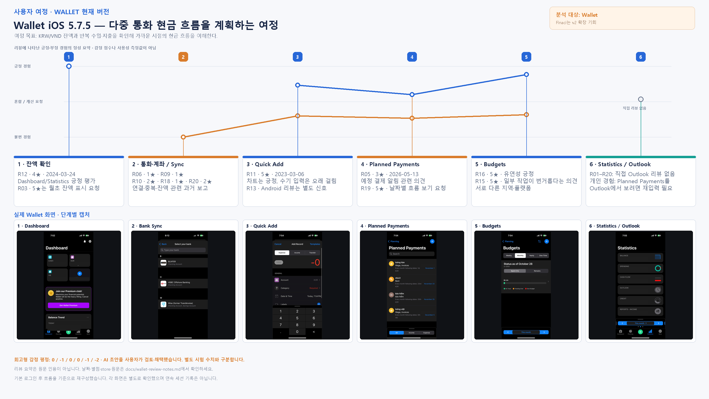
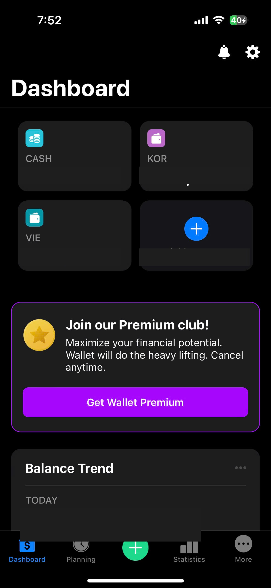
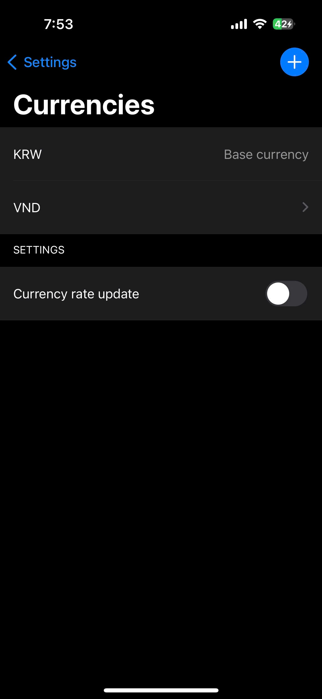
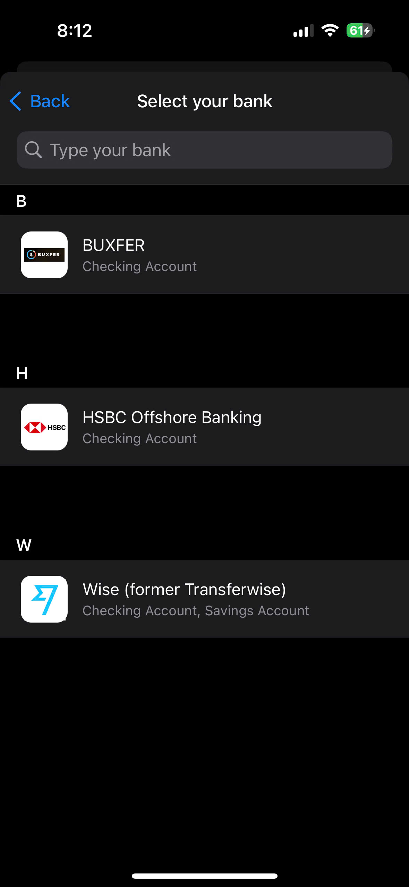
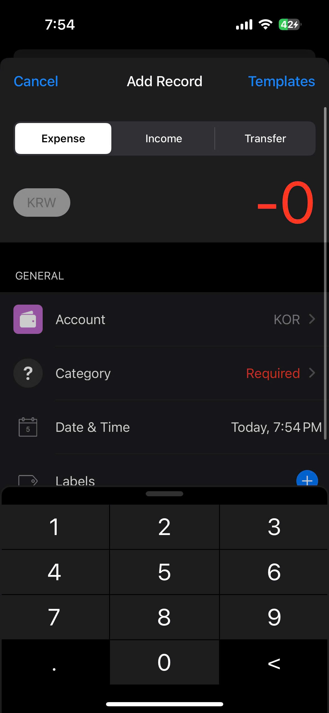
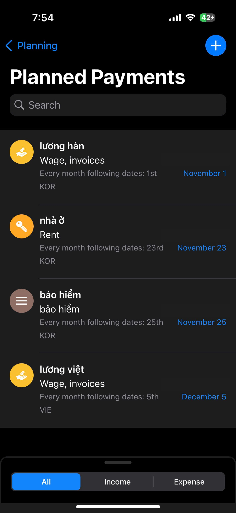
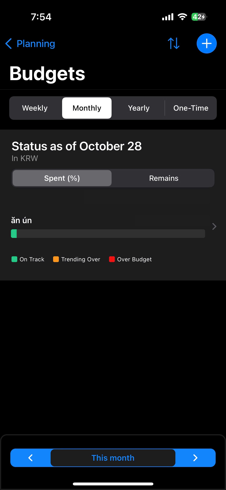
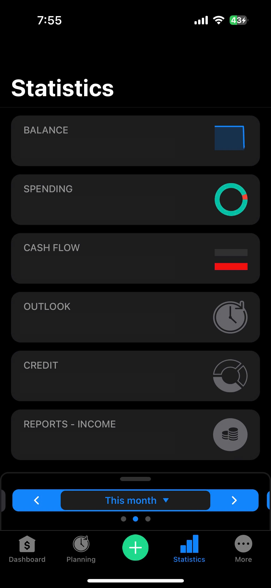
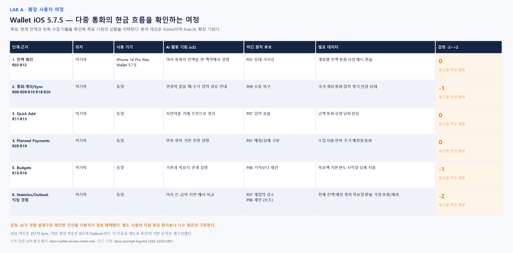
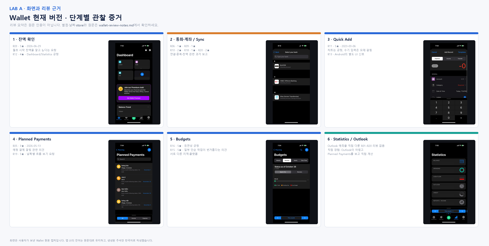

# Wallet 현행 User Journey

분석 대상은 Wallet iOS 5.7.5다. finaci는 확장 기회에만 제시하며 현행 화면으로 넣지 않는다.

## 목표와 재구성 방식

한국에 거주하며 KRW/VND 수입·지출을 관리하는 유학생이 잔액과 반복 항목을 확인하고 가까운 시점의 현금 흐름을 이해하려는 과업이다. 이 persona는 finaci 전체 대상의 한 사례다.

사용자는 각 흐름을 따로 시험했다. 로그인 뒤 기본 흐름을 바탕으로 Dashboard, Currency/Sync, Quick Add, Planned Payments, Budgets, Statistics/Outlook 순서를 재구성했다. 한 번의 연속 세션이나 소요 시간 기록은 아니다.

파랑/주황 곡선은 QANDA 예시처럼 리뷰의 긍정/부정 신호를 정성적으로 묶은 것이다. 아래의 개인 감정 점수와 구분한다. 화면은 사용자가 촬영한 Wallet이고 리뷰는 여러 지역/플랫폼의 공개 자료다.

## 단계별 과업·화면·리뷰

| 단계 | 사용자의 과업과 실제 화면 | 연결한 리뷰와 해석 |
|---|---|---|
| 1. Dashboard | 계좌 grid와 Balance Trend로 현재 돈을 확인한다. Settings/Currencies에는 KRW base와 VND가 있다. | R12, 4★, 2024-03-24, Apple US: Dashboard/Statistics와 다중 통화 수기 입력 긍정. R03, 5★, 2026-06-29, US: 월초 잔액을 더 분명히 보고 싶다는 요청. |
| 2. Currency/Sync | 통화를 추가하고 계좌 입력 방식을 고른다. 사용자는 Vietnam을 찾지 못했다. South Korea의 Show all banks에는 BUXFER·HSBC Offshore Banking·Wise가 보였다. 실제 연결은 시험하지 않았다. | R12의 일부 은행 부재, R17(5★, 2026-09-01, UK)의 FX/미동기화 상태 요청. R06/R09/R10/R18/R20의 연결·중복·잔액 불만을 리뷰 저점으로 묶었다. 현재 iOS 재현 증거는 아니다. |
| 3. Quick Add | Expense/Income/Transfer에서 금액·계좌·분류·통화·날짜를 입력한다. Templates로 반복 입력을 줄일 수 있다. | R11, 5★, 2023-03-06, US: 차트는 좋지만 수기 입력이 오래 걸림. R13, 1★, 2026-08-29, Android: UI/분류 불편. Android 의견을 iOS 버그로 옮기지 않는다. |
| 4. Planned Payments | 반복 수입·지출의 예정일과 통화를 본다. All/Income/Expense 필터가 있다. | R05, 3★, 2026-05-13, US: 예정 결제 알림/환불 요청. R19, 5★, 2026-03-31, UK: 날짜별 흐름 요청. Outlook 재입력을 직접 말한 리뷰는 아니다. |
| 5. Budgets | Weekly/Monthly/Yearly/One-Time 예산과 사용률을 본다. 사용자는 월 시작일을 바꾸지 못해 중간 시작 시 맞지 않았다고 보고했다. | R16, 5★, 2026-08-24, UK: 예산과 여러 수입원 관리의 유연성 긍정. R15, 5★, 2026-04-01, Android: 옵션이 많아 단순 작업도 번거롭다는 의견. 시작일 직접 리뷰는 없다. |
| 6. Statistics/Outlook | Balance/Spending/Cash Flow/Outlook을 본다. 사용자는 Planned Payments의 항목을 Outlook에서 보려면 다시 입력해야 했다고 확인했다. | R11의 수입·지출 비교, R03의 잔액 표시 요청은 인접 근거다. R01–R20에는 Outlook/목표일 전망의 직접 리뷰가 없다. 개인 경험을 별도 근거로 둔다. |

## 수업 확장 worksheet

W05/W06의 단계·위치·사용 기기·AI 활용 기회·어긴 원칙 후보·필요 데이터·감정 항목을 유지한다. 실제 위치는 기록하지 않았다. P07을 주원칙, P06을 보조로 고른 것은 사용자가 확인한 결정이다. 다른 P번호는 검토 후보다.

| 단계 | 위치 | 사용 기기 | AI/finaci v2 기회 | 원칙 후보 | 필요 데이터 | 회고형 감정 |
|---|---|---|---|---|---|---:|
| 1. Dashboard | 미기록 | iPhone 14 Pro Max, Wallet5.7.5 | 여러 통화 잔액 설명 | P01 현재/환산 구분 | 계좌·통화·시점·환율 가정 | 0 |
| 2. Currency/Sync | 미기록 | 동일 | 연결이 없을 때 수기 대안 안내 | P09 복구/대안 | 국가·통화·입력 방식 | -1 |
| 3. Quick Add | 미기록 | 동일 | 자연어를 거래 초안으로 정리 | P07 입력 효율 | 금액·통화·유형·날짜·분류 | 0 |
| 4. Planned Payments | 미기록 | 동일 | 반복 항목 기반 전망 설명 | P01 예정/실제 구분 | 반복 주기·금액·예정일·통화 | 0 |
| 5. Budgets | 미기록 | 동일 | 기한과 목표의 관계 설명 | P06 기억 부담 | 한도·기간·시작일·실제 지출 | -1 |
| 6. Statistics/Outlook | 미기록 | 동일 | 미리 쓴 급여 지연 예시 비교 | P07 재입력 감소, P06 재인 | 잔액·항목·목표일·환율·시나리오 | -2 |

점수는 AI가 사용자의 경험 설명으로 초안을 작성한 뒤 사용자가 검토하고 채택한 **회고형 주관 평정**이다(L032–L033, L051). 점수 제안의 AI 기여를 숨기지 않는다. 별도 시험에서 즉시 응답한 원자료나 여러 참여자의 평균으로 쓰지 않는다. 0점 단계는 구체적인 불편 보고가 없었던 단계로 제안한 값이다.

## 두 최저점과 분석 우선순위

- 리뷰 최저점은 2단계 Sync다. R06/R09/R10/R18/R20의 1–2★ 의견이 모인다. 과거·다지역 표본으로 현재 iOS 문제 발생률을 뜻하지 않는다.
- 개인 과업 최저점은 6단계다. 이미 입력한 예정 항목을 Outlook에서 쓰기 위해 재입력한 경험과 -2 평정이 근거다.
- Fishbone는 직접 경험했고 UI 범위에서 설명 가능한 6단계를 선택했다. 리뷰 빈도가 가장 높은 주제와 다르다는 이유를 발표에서 밝힌다.
- Goals는 관찰한 iOS 화면에서 찾지 못했고 2026-10-28 확인한 Help Center도 iOS 미지원으로 표시했다. Android까지 없다고 일반화하지 않는다.

## 출처와 범위

사용자가 2026-10-28 제공한 21개 캡처와 경험 설명, R01–R20, W05 p17/W06 pp9–10/W07 ①-3을 사용했다. 숫자 iOS 버전·위치·연속 세션 시간은 미기록이다. 화면만으로 Outlook 내부 계산이나 공통 데이터 구조를 단정하지 않는다. `wallet-review-notes.md`, `prompt-log.md` L029–L035/L046/L051을 함께 참조한다.
