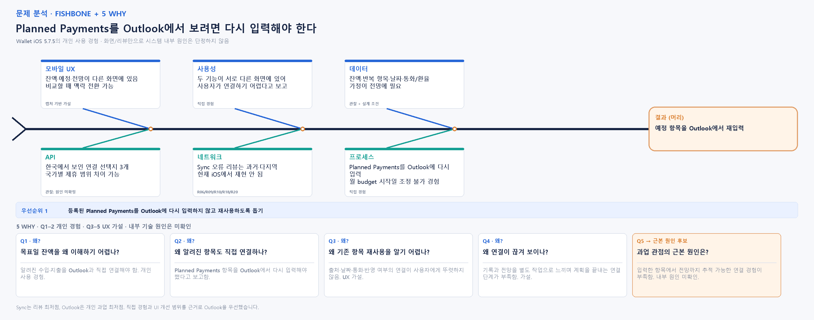

# Bước 4 — Fishbone + 5 Why

**Trạng thái:** Người dùng đã chốt nguyên nhân gốc ứng viên ở mức UX; nguyên nhân kỹ thuật/nội bộ chưa xác minh. Chốt ngày 2026-10-28; hoàn thiện chuỗi giải thích UX ngày 2026-10-29 theo L046.

## Vấn đề cần phân tích

Trong trải nghiệm cá nhân đã kể, Planned Payments theo dõi riêng; muốn xem khoản đó trong Outlook thì người dùng phải nhập lại vì hai phần không liên thông. Ngân sách tháng cũng không cho chỉnh ngày bắt đầu theo người dùng.

**Phạm vi chính đề xuất:** giúp người dùng nhìn trước dòng tiền từ các khoản thu/chi đã biết. Chu kỳ ngân sách cố định là một vấn đề phụ có liên quan, nhưng không đồng nhất với dự phóng dòng tiền.

**Giới hạn phát biểu:** Đây là trải nghiệm của người làm bài và ảnh chụp Wallet iPhone 5.7.5; chưa đại diện cho tất cả người dùng. Chưa xác minh cơ chế tính bên trong Outlook. Chưa dùng review R01–R20 để khẳng định vấn đề này vì không có review trực tiếp về tình huống đó.

## Fishbone — sáu góc nhìn

| Góc nhìn (theo W07) | Nguyên nhân khả dĩ | Căn cứ hiện có / điều chưa biết |
|---|---|---|
| Mobile UX | Thông tin số dư hiện tại, khoản định kỳ và Outlook nằm ở nhiều màn; có thể tăng công chuyển ngữ cảnh trên màn hình điện thoại. | Ảnh xác nhận các màn khác nhau; chưa đo số lần chạm hoặc so sánh với màn hình rộng. |
| Usability | Planned Payments và Outlook không liên thông theo trải nghiệm; để thấy dữ liệu dự kiến trong Outlook, người dùng phải nhập lại. | Người dùng trực tiếp xác nhận; chưa tái kiểm tra trên phiên bản khác hoặc với tài khoản khác. |
| Data | Dự phóng cần xử lý nhiều account/currency, ngày đến hạn và phân biệt khoản định kỳ đã biết với khoản phát sinh chưa biết. | Ảnh cho thấy KRW/VND và Planned Payments; chưa xác minh công thức Outlook hay giả định tỷ giá. |
| API | Kết nối ngân hàng/nhà cung cấp có thể giới hạn đồng bộ tự động và độ phủ quốc gia. | Ảnh Bank Sync cho thấy các lựa chọn theo quốc gia; chưa thử kết nối. Đây là ràng buộc hệ sinh thái, không phải nguyên nhân chính đã chọn. |
| Network | Lỗi kết nối có thể làm giao dịch thiếu, trùng hoặc chậm cập nhật, khiến người dùng khó tin vào số dư. | R06/R09/R10/R18/R20 là review lịch sử ở nhiều vùng; chưa kiểm chứng trên Wallet iOS 5.7.5 hiện tại. |
| Process | Người dùng nhập khoản thu/chi định kỳ nhưng vẫn phải tự tổng hợp; kỳ ngân sách tháng không cho chỉnh ngày bắt đầu theo trải nghiệm cá nhân. | Người dùng trực tiếp xác nhận cả hai điều; đây là symptom/procedure, chưa chứng minh nguyên nhân hệ thống bên trong. |

**Ngoài phạm vi nguyên nhân gốc chính:** độ phủ Bank Sync phụ thuộc thị trường và đối tác ngân hàng. Người dùng chọn không lấy đây làm pain point chính vì nó thiên về partnership.

## 5 Why — chuỗi giải thích UX và giới hạn

Chọn kết quả từ **bước 6, Statistics/Outlook**, low point theo mục tiêu tác vụ cá nhân. Bước 2 vẫn là low point theo số review. Chọn bước 6 vì người dùng trực tiếp gặp và có thể đề xuất sửa trong phạm vi UI; không nói đây là vấn đề review phổ biến nhất.

| Câu hỏi nối tiếp | Giải thích | Mức bằng chứng |
|---|---|---|
| Q1. Vì sao khó trả lời số dư ở ngày mục tiêu? | Người dùng phải ghép các khoản thu/chi đã biết với Outlook thay vì đọc một dòng tiền theo ngày. | Lời kể trực tiếp về phải tự tính/nối thông tin. |
| Q2. Vì sao vẫn phải tự ghép các khoản đã biết? | Theo trải nghiệm, khoản đã có trong Planned Payments phải nhập lại để xem ở Outlook. | L029–L030: trải nghiệm trực tiếp, chưa kiểm chứng cơ chế bên trong. |
| Q3. Vì sao người dùng không nhận biết việc dùng lại khoản đó? | Liên hệ giữa nguồn khoản, ngày, tiền tệ và trạng thái được tính vào Outlook chưa rõ với người dùng trong luồng đã thử. | Phân tích UX từ lời kể và màn hình; không khẳng định backend không dùng chung dữ liệu. |
| Q4. Vì sao mối liên hệ này quan trọng nhưng bị đứt trong trải nghiệm? | Người dùng cảm nhận ghi khoản và xem tương lai là hai công việc riêng, thiếu bước nối để hoàn tất tác vụ lập kế hoạch. | Giả thuyết về tổ chức trải nghiệm, chưa phải ý định thiết kế của Wallet. |
| Q5. Vì sao tác vụ không hoàn tất ngay từ khoản đã nhập? | Thiếu mối nối có thể nhận biết và truy ngược từ khoản đã đăng ký tới kết quả dự kiến. Đây là nguyên nhân gốc đề xuất ở mức UX. | Giả thuyết gốc UX; nguyên nhân tổ chức/kỹ thuật cần nghiên cứu thêm. |

Chuỗi này đi từ khó hoàn tất tác vụ tới khả năng truy ngược nguồn dữ liệu. Không dùng hậu quả của vấn đề làm nguyên nhân mới. Điểm thiết kế có thể kiểm tra là A-5/B-3 giữ cùng tên·ngày·tiền tệ, A-6/B-5 nêu rõ khoản nào được tính, A-4/B-6 phân biệt hiện tại với dự kiến. Chưa đo hiệu quả bằng usability test.

## Kết luận đã chốt trong phạm vi UX

- **Triệu chứng đã được người dùng xác nhận:** Planned Payments và Outlook không liên thông; để xem khoản dự kiến trong Outlook phải nhập lại. Ngân sách tháng cũng không chỉnh được ngày bắt đầu.
- **Nguyên nhân gốc UX đã chốt:** Wallet chưa nối Planned Payments với Outlook để tái sử dụng khoản đã nhập; vì vậy việc theo dõi chưa tự chuyển thành dữ liệu lập kế hoạch và người dùng phải nhập/nối lại. Nguyên nhân thiết kế/kỹ thuật nội bộ chưa xác minh.
- **Thiết kế finaci có thể kiểm tra:** biểu diễn dòng tiền theo mốc ngày/tháng, nêu các khoản được tính và ghi rõ khoản phát sinh chưa tính; sau đó mới nối với goal.
- **Hướng sang bước 5:** màn hình sẽ biểu diễn dòng tiền/số dư dự kiến theo mốc thời gian, dùng các khoản cố định đã nhập; hiển thị rõ giả định và loại khoản chưa tính.

## Bằng chứng gắn vào bài

- Trải nghiệm do người dùng cung cấp trong chat; ghi tại `docs/prompt-log.md` L018–L020.
- Ảnh Wallet iPhone 5.7.5: `docs/screenshots/journey/wallet-planned-payments-redacted.jpg`, `wallet-statistics-redacted.jpg`, `wallet-budget-redacted.jpg`.
- Review R01–R20: hiện chưa có review trực tiếp về Outlook/dự phóng mục tiêu; không gán review lân cận thành bằng chứng cho kết luận này.
- Nielsen để xem xét khi phác màn: P07 (hiệu quả/linh hoạt thao tác) là nguyên tắc chính đã chọn cho nhập lặp; P06 (nhận biết/tái sử dụng dữ liệu đã có) là nguyên tắc phụ. Chưa kết luận Wallet vi phạm.
