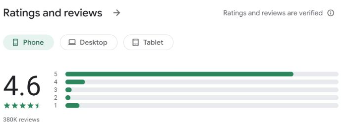

# Wallet review research — snapshot ban đầu

Ngày thu thập: **2026-10-28 (KST)**. Tên người viết review đã lược bỏ; dùng mã R01–R20. Đây là mẫu thuận tiện lấy từ phần review công khai đang hiển thị, không đại diện cho mọi người dùng. Phân loại/Nielsen do AI hỗ trợ; trọng tâm P07 chính/P06 phụ đã được người dùng chốt sau khi đối chiếu trải nghiệm Wallet 5.7.5. Các review lịch sử vẫn giữ giới hạn theo vùng và phiên bản.

## Store và giới hạn dữ liệu

| Store / khu vực | Điểm và lượt đánh giá tại ngày lấy | Phân bố sao | Ghi chú |
|---|---:|---|---|
| Apple App Store / KR / iOS | **4.8/5, 38 ratings** | Trang KR và lookup công khai chỉ cho điểm trung bình + tổng số; không thấy histogram sao. | Trang KR chỉ hiển thị 2 review có nội dung; cả hai 5★, cũ và ít giá trị UX. Không thể suy ra phân bố từ trung bình. |
| Apple App Store / US / iPhone | **4.6/5, 5.9K ratings** | Không hiển thị phân bố sao trên trang review công khai. | Đọc được 10 review; ngày/sao có trên từng thẻ. Một số review cũ; ghi năm đúng theo trang. Bổ sung góc nhìn iOS quốc tế, không nhập chung với KR. |
| Apple App Store / UK / iPhone | **4.5/5, 889 ratings** | Không hiển thị phân bố sao trên trang review công khai. | Có 10 review trên trang; lấy 5 review (R16–R20) để đạt mốc 20 của hướng dẫn thực hành W07. Ghi rõ UK, không nhập vào KR. |
| Google Play / US query / Android | **4.6/5, 388K reviews** ở phần tổng quan; bộ lọc Phone hiển thị **4.7/5, 380K reviews**. | Phone: 5★ 316,980 (83.44%); 4★ 27,465 (7.23%); 3★ 8,844 (2.33%); 2★ 7,078 (1.86%); 1★ 19,487 (5.13%). Các số sao cộng thành 379,854, xấp xỉ số làm tròn 380K. | Giữ cả hai con số theo vùng hiển thị trong Play, không trộn với iOS. Review mẫu Android được ghi riêng. URL có `hl=en&gl=US`; đây là vùng truy vấn, không xác nhận quốc tịch người viết. |

Nguồn chính: [Apple App Store KR](https://apps.apple.com/kr/app/wallet-%EA%B0%9C%EC%9D%B8-%EA%B8%88%EC%9C%B5/id1032467659), [Apple App Store US — reviews](https://apps.apple.com/us/app/wallet-daily-budget-profit/id1032467659?platform=iphone&see-all=reviews), [Apple App Store UK — reviews](https://apps.apple.com/gb/app/wallet-budget-money-manager/id1032467659?platform=iphone&see-all=reviews), [Google Play US query](https://play.google.com/store/apps/details?id=com.droid4you.application.wallet&hl=en&gl=US). Số liệu là snapshot truy cập ngày 2026-10-28; W07 yêu cầu capture histogram sao khi store cung cấp. App Store không công khai histogram trên các trang KR/US/UK; không suy diễn phân bố Apple từ điểm trung bình. Google Play có histogram riêng cho Android.

## Bổ sung histogram gốc — 2026-10-29 (KST)

Nguồn: [Google Play US, bộ lọc Phone](https://play.google.com/store/apps/details?id=com.droid4you.application.wallet&hl=en_US&gl=US). Đây là snapshot mới ngày 2026-10-29, tách với review R01–R20 và số liệu ngày 2026-10-28 ở trên. Ảnh được cắt từ giao diện store, không dựng lại histogram.

| Snapshot mới | Giá trị |
|---|---:|
| Điểm bộ lọc Phone trên ảnh | 4.6/5 |
| Số lượt Phone được làm tròn trên ảnh | 380K |
| 5★ (giá trị accessibility của store) | 317,051 |
| 4★ | 27,451 |
| 3★ | 8,845 |
| 2★ | 7,079 |
| 1★ | 19,472 |
| Tổng số đếm chính xác | 379,898 |

Header app 388K là số tổng quan khác phạm vi. Không trộn 388K với mẫu Phone; không gộp Android với Apple hoặc vùng khác. Giá trị chính xác được đọc từ accessibility của trang; các thanh sao và số làm tròn có trong ảnh gốc. Không đổi ngày review để làm chúng trông mới hơn. App version không được hiển thị cho mọi review, vì vậy ghi là chưa có thay vì suy đoán.

## Review đã mã hóa

Trích dẫn ngắn, ẩn tên tác giả. Những phần không nằm trong trích dẫn được tóm tắt, không đặt trong ngoặc kép. Chủ đề có thể gắn nhiều nhãn cho một review; số lượng dưới đây là số record trong mẫu, không phải tỷ lệ người dùng.

| ID | Store / nền tảng | Ngày trên store | Sao | Bằng chứng ngắn hoặc ý chính | Nhãn sơ bộ / giới hạn |
|---|---|---:|---:|---|---|
| R01 | Apple KR / iOS | 2020-06-09 | 5★ | “단연 으뜸이다” (khen chung: tốt nhất trong các app từng dùng) | Tích cực nhưng chung chung; không chỉ ra yếu tố UX cụ thể. |
| R02 | Apple KR / iOS | 2024-01-03 | 5★ | “PUSAN” | Không đủ nội dung để mã hóa pain point hay nguyên tắc. |
| R03 | Apple US / iOS | 2026-06-29 | 5★ | “how much money we are starting the month with” | Muốn nhìn rõ số dư mang sang đầu tháng; P06 (nhận biết thay vì phải nhớ) là ánh xạ ứng viên. Đề xuất tính năng, không chứng minh cách hiện tại hoàn toàn không có. |
| R04 | Apple US / iOS | 2026-08-16 | 5★ | Khen app, báo Apple Pay/Shortcuts automation ngừng hoạt động. | Tính ổn định / phục hồi lỗi; P09 ứng viên. Developer response hướng dẫn kiểm tra Shortcuts, nên không khẳng định lỗi hiện còn. |
| R05 | Apple US / iOS | 2026-05-13 | 3★ | Phản ánh không nhận push cho khoản sắp thanh toán; muốn thao tác refund ngay từ giao dịch. | Trạng thái khoản đến hạn / thao tác sửa; P01, P03 ứng viên. Developer response khi đó nói push iOS mới hỗ trợ một phần; lịch sử, cần kiểm tra app hiện tại. |
| R06 | Apple US / iOS | 2024-07-29 | 1★ | Dữ liệu iOS không đồng bộ sang web, bị yêu cầu thiết lập lại tiền tệ gốc/số dư ban đầu. | Đồng bộ và phản hồi lỗi; P01/P09 ứng viên. Báo cáo lịch sử, không chứng minh lỗi 5.7.5. |
| R07 | Apple US / iOS | 2021-05-28 | 5★ | Khen giao diện, biểu đồ, đa tiền tệ; người viết từng nhầm xóa dữ liệu với xóa tài khoản rồi sửa được sau phản hồi hỗ trợ. | Tích cực về P02/P07; nhầm lẫn và phục hồi có thể gợi ý P03/P09. Rất cũ, không suy ra lỗi hiện tại. |
| R08 | Apple US / iOS | 2017-01-23 | 2★ | Nói một bản cập nhật làm việc phân loại/mã hóa giao dịch trở nên bất tiện. | Lịch sử về thay đổi/nhất quán; P04/P07 ứng viên. Quá cũ, không dùng làm kết luận hiện trạng. |
| R09 | Apple US / iOS | 2024-03-06 | 1★ | Không kết nối được credit union sau nhiều lần thử; đã tìm FAQ và liên hệ hỗ trợ. | Lỗi kết nối, hỗ trợ và phục hồi; P09/P10 ứng viên. Ngân hàng/khu vực cụ thể; không khái quát thành lỗi cho mọi ngân hàng. |
| R10 | Apple US / iOS | 2023-11-29 | 2★ | Sau khi kết nối lại, giao dịch bị nhân đôi; người viết mất công xóa thủ công và thường bị đăng xuất. | Ngăn lỗi/trùng lặp, phục hồi và hiệu quả; P05/P09/P07 ứng viên. Cũ, phụ thuộc kết nối ngân hàng. |
| R11 | Apple US / iOS | 2023-03-06 | 5★ | Khen biểu đồ và so sánh chi tiêu với thu nhập; nhập thủ công mất thời gian. | Tích cực về nhận biết tình hình/P06; hiệu quả nhập liệu/P07 là cơ hội. Cũ. |
| R12 | Apple US / iOS | 2024-03-24 | 4★ | Khen Dashboard/Statistics, nhập tay nhiều tiền tệ và liên kết Wise; phàn nàn thiếu một số ngân hàng và tách giao dịch. | Tích cực về P02/P06; linh hoạt thao tác P07. Thiếu ngân hàng tùy thị trường; không dùng làm bằng chứng KR. |
| R13 | Google Play US query / Android | 2026-08-29 | 1★ | “UI is clunky, illogical”; phàn nàn nhập ngân hàng sai danh mục và khó tùy chỉnh. | Nhập liệu/khả năng tùy chỉnh; P07/P08 ứng viên. Developer response nói có quy tắc tự động và danh mục con; không khẳng định mọi yêu cầu danh mục đều được hỗ trợ. Android, không gán trực tiếp cho iOS. |
| R14 | Google Play US query / Android | 2026-07-31 | 5★ | Khen khả năng tùy chỉnh; muốn nhiều nhóm chia sẻ và mở rộng thêm nước Đông Nam Á. | Tích cực về P07; yêu cầu phạm vi chia sẻ/thị trường. Không chứng minh thiếu ngân hàng Việt Nam/Hàn Quốc. Android. |
| R15 | Google Play US query / Android | 2026-04-01 | 5★ | “too many options”; người viết tìm thấy template nhưng vẫn thấy một số việc đơn giản bị rườm rà. | Khả năng tìm thấy chức năng và giảm độ phức tạp; P06/P08 ứng viên. Review 5★ cho thấy phản ánh usability không đồng nghĩa đánh giá tổng thể thấp. Android. |
| R16 | Apple UK / iOS | 2026-08-24 | 5★ | Khen Wallet đơn giản, dễ dùng, linh hoạt cho ngân sách và thu nhập nhiều nguồn. | Positive UX, tùy biến, tổ chức tài chính cá nhân; P02/P07 ứng viên. Khu vực UK. |
| R17 | Apple UK / iOS | 2026-09-01 | 5★ | Khen cách hiển thị đa tiền tệ; muốn ghi chú giao dịch ngoại tệ đang chờ và biết vì sao tài khoản chưa đồng bộ. | Điểm tốt P02; trạng thái/chỉnh sửa giao dịch và đồng bộ P01/P03/P09 là ứng viên. Review mới nhưng tính năng/ngân hàng phụ thuộc khu vực. |
| R18 | Apple UK / iOS | 2024-02-21 | 1★ | Báo giao dịch trùng và số dư sai sau khi đồng bộ; phản ánh sửa thủ công và hỗ trợ chậm. | Lỗi dữ liệu, phục hồi, hỗ trợ; P05/P09/P10 ứng viên. Báo cáo lịch sử, không khẳng định tồn tại ở 5.7.5. |
| R19 | Apple UK / iOS | 2026-03-31 | 5★ | Khen app; đề nghị xem lịch thu/chi theo ngày, tách khoản dùng chung và đối chiếu tiền hoàn. | Positive experience + yêu cầu tính năng; P06/P07 ứng viên. Năm lấy từ ngày ISO trên trang. |
| R20 | Apple UK / iOS | 2024-03-09 | 2★ | Phản ánh tài khoản đồng bộ không tốt và giao dịch vào sai danh mục lặp lại. | Đồng bộ/tính đúng dữ liệu; P01/P05/P09 ứng viên. Review lịch sử, không khẳng định còn xảy ra ở 5.7.5. |

## Feedback có liên quan UI/UX — đọc theo mức độ trực tiếp

### 1. Phản hồi nói thẳng về thao tác, độ dễ hiểu hoặc thông tin cần nhận biết

- **R13 — UI khó hiểu/tùy chỉnh danh mục (Google Play US, Android, 1★, 2026-08-29):** người viết gọi UI là “clunky, illogical” và nói giao dịch nhập từ ngân hàng vào sai danh mục, khó tùy chỉnh. Có thể liên hệ **P02** (khái niệm/danh mục có khớp kỳ vọng không), **P07** (dễ sửa/tùy chỉnh), **P08** (độ phức tạp). Phản hồi nhà phát triển nói có automatic rules/subcategories; không đủ căn cứ để kết luận app không có cách sửa.
- **R15 — quá nhiều lựa chọn, việc đơn giản rườm rà (Google Play US, Android, 5★, 2026-04-01):** người viết vẫn đánh giá tổng thể 5★ nhưng nói có “too many options” và một số tác vụ đơn giản tốn công. Ứng viên **P07/P08**: tìm đường tắt/giảm tải lựa chọn. Đây là tín hiệu UX đáng chú ý; không chứng minh tất cả người dùng thấy app phức tạp.
- **R11 — nhập tay mất thời gian (Apple US, iOS, 5★, 2023-03-06):** khen biểu đồ và so sánh thu/chi, đồng thời nói ghi giao dịch thủ công mất thời gian. Ứng viên **P07**; review cũ và tác giả vẫn cho điểm cao.
- **R03 — muốn thấy số dư đầu tháng (Apple US, iOS, 5★, 2026-06-29):** phản hồi muốn biết tháng bắt đầu với bao nhiêu tiền. Ứng viên **P06** (nhận biết thay vì phải nhớ); đây là yêu cầu tăng visibility, không xác nhận màn hiện tại hoàn toàn không có số liệu.
- **R05 — nhắc khoản đến hạn và thao tác refund (Apple US, iOS, 3★, 2026-05-13):** người viết nói không nhận push cho khoản sắp thanh toán và muốn xử lý refund ngay từ giao dịch. Có thể liên hệ **P01** (nhận biết khoản đến hạn) và **P03/P07** (đường thao tác/chỉnh sửa); response cùng thời điểm cho biết push iOS còn hỗ trợ một phần, nên cần coi là giới hạn/bug lịch sử.

### 2. Lỗi kết nối/dữ liệu tạo ra trải nghiệm UX xấu

R06 (không đồng bộ iOS–web), R09 (không kết nối được một credit union), R10 (sau sync lại bị trùng, phải xóa tay/đăng nhập lại), R18 (trùng giao dịch/số dư sai và hỗ trợ chậm), R20 (sync không tốt, giao dịch sai danh mục) là tín hiệu mạnh về **độ tin cậy, phòng lỗi và phục hồi** — ứng viên **P01/P05/P09/P10**. Chúng ảnh hưởng UX vì người dùng không biết dữ liệu nào đúng và phải tự sửa; nhưng nguyên nhân có thể là tích hợp/ngân hàng/dữ liệu, không thể gán hết cho layout. Nhiều review có từ 2023–2024, khác khu vực và một số khác nền tảng; không dùng để khẳng định lỗi hiện vẫn tồn tại trên iPhone 5.7.5.

### 3. Phản hồi tích cực là bằng chứng UX tốt, không chỉ để tìm lỗi

R07 nêu giao diện/biểu đồ/đa tiền tệ; R11 khen charts và đối chiếu thu/chi; R12 khen Dashboard/Statistics và nhập đa tiền tệ; R16 mô tả app đơn giản/dễ dùng/linh hoạt; R17 khen hiển thị đa tiền tệ. Các review này hỗ trợ **P02/P06/P07** như điểm mạnh, dù trải nghiệm phụ thuộc phiên bản/khu vực.

### Kết luận có thể trình bày

Trong mẫu 20 review, có phản hồi UX cụ thể về **độ phức tạp/khả năng tìm thao tác (R13, R15), thời gian nhập liệu (R11), khả năng nhìn ra số dư quan trọng (R03), và nhắc/chỉnh giao dịch (R05)**. Nhóm sync (R06/R09/R10/R18/R20) cũng tạo hậu quả UX rõ, nhưng phần lớn là reliability/data issue. Review cho thấy người dùng khác có các phản hồi này; chúng **không chứng minh chính sinh viên đã gặp chúng**. Mẫu nhiều store/khu vực, chỉ 2 review Apple KR; do đó không kết luận đây là trải nghiệm phổ biến của du học sinh Việt/Hàn.

Riêng hướng **mục tiêu học phí/Goals**, mẫu R01–R20 không có review trực tiếp. Có thể chọn nó dựa trên trải nghiệm của chính sinh viên và việc Goals không khả dụng trên iOS theo Help Center, còn R03/R11/R12 chỉ làm bằng chứng lân cận về visibility, dòng tiền và đa tiền tệ.

## Triage: phản hồi cũ còn đúng với Wallet iPhone 5.7.5 không?

Ảnh người dùng chụp ngày 2026-10-28 dùng để kiểm tra xem UI hiện tại có bằng chứng liên quan hay không. “Chưa xác nhận” nghĩa là ảnh tĩnh không đủ để gọi vấn đề đã hết hoặc còn; không phải kiểm thử đầy đủ.

| Review / chủ đề | Đối chiếu với màn hình hiện tại | Kết luận tạm thời |
|---|---|---|
| **R03 — số dư đầu tháng** | Dashboard có Balance Trend và Statistics có bộ chọn kỳ; ảnh không cho thấy số dư đầu kỳ được ghi nhãn rõ. | **Chưa xác nhận đã giải quyết.** Có công cụ nhìn xu hướng/số dư, nhưng không thấy rõ con số bắt đầu tháng trong ảnh. Cần mở chi tiết trend/kỳ tháng để kiểm tra. |
| **R05 — nhắc khoản đến hạn/refund** | Planned Payments hiển thị lịch/ngày và trạng thái xác nhận; chưa có ảnh setting notification hoặc chi tiết transaction/refund. | **Chưa xác nhận.** Màn hình lịch tồn tại nhưng không chứng minh push hoạt động hay refund thao tác được từ giao dịch. |
| **R06 — iOS không đồng bộ web** | Không có flow đồng bộ iOS–web trong ảnh. | **Không thể đánh giá từ ảnh.** Review 2024; không coi là lỗi hiện hành. |
| **R07 — nhầm xóa dữ liệu/tài khoản** | Không có flow xóa dữ liệu hoặc xóa tài khoản trong ảnh. | **Không thể đánh giá; review 2021 đã cũ.** |
| **R08 — phân loại sau cập nhật trở nên bất tiện** | Có form chọn Category hiện tại, nhưng không có so sánh trước/sau cập nhật hay nhiệm vụ phân loại hoàn chỉnh. | **Không thể xác nhận; review 2017 quá cũ.** |
| **R09 — không kết nối credit union** | Ảnh cho thấy lựa chọn kết nối tại South Korea; không thử ngân hàng US hoặc kết nối thật. | **Không thể áp dụng trực tiếp.** Review phụ thuộc quốc gia/nhà cung cấp, không chứng minh lỗi ở KR. |
| **R10 — trùng giao dịch/đăng xuất sau reconnect** | Không chạy Bank Sync thật; ảnh chỉ cho thấy nhà cung cấp và phương thức nhập. | **Chưa xác nhận.** Phải kiểm thử có chủ đích để đánh giá trùng lặp/đăng xuất; không nên dùng tài khoản thật cho bài này. |
| **R11 — nhập tay tốn thời gian** | Quick Add có nhiều trường và bàn phím số; Templates có thể lưu mẫu để nhập lại. | **Chưa xác nhận đã giải quyết.** Template là cơ chế giảm thao tác lặp, nhưng ảnh không cho biết thời gian/số lần chạm hoặc độ dễ tìm trường. |
| **R12 — thiếu ngân hàng/tách giao dịch** | Người dùng báo Vietnam không có trong country list; ảnh mới xác nhận ba lựa chọn dưới South Korea: BUXFER, HSBC Offshore Banking, Wise. Chưa thử split transaction. | **Độ phủ là giới hạn hiện thấy trong lần khảo sát iOS/KR này;** không khái quát các thị trường. Split transaction **chưa đánh giá**. |
| **R13 — UI Android rối, sai danh mục/tùy chỉnh** | Ảnh iOS có trường Category nhưng không cho thấy giao dịch import/sai danh mục hoặc chỉnh automatic rules; khác nền tảng. | **Chưa xác nhận trên iOS.** Coi là tín hiệu Android để nêu câu hỏi P07/P08, không đưa vào danh sách bug iPhone. |
| **R15 — quá nhiều options/làm việc đơn giản rườm rà** | More hiển thị nhiều module; Quick Add form nhiều trường nhưng có Templates và tab chính. Chưa quan sát người dùng khác tìm tính năng. | **Có thể đặt giả thuyết về độ dày tính năng, chưa chứng minh còn là usability issue.** Không kết luận “rối” chỉ từ số lượng mục. Android review. |
| **R17 — ghi chú giao dịch FX đang chờ/lý do chưa sync** | Currencies xác nhận KRW/VND; chưa có ảnh transaction pending hoặc lỗi sync giải thích nguyên nhân. | **Đa tiền tệ cơ bản được xác nhận; yêu cầu pending/sync status chưa đánh giá.** |
| **R18/R20 — trùng, sai số dư/danh mục sau sync** | Không thử sync thật; ảnh không có error, duplicate hoặc recovery state. Review năm 2024 và thị trường UK. | **Chưa xác nhận trên iPhone 5.7.5.** Có hậu quả UX nghiêm trọng nếu xảy ra, nhưng nguồn gốc có thể là tích hợp/dữ liệu. |
| **R19 — lịch thu chi theo ngày/tách khoản chung/hoàn tiền** | Planned Payments cho thấy ngày các khoản định kỳ; không có lịch toàn bộ giao dịch theo ngày hay split/shared/refund flow. | **Một phần chức năng lịch dự kiến hiện có;** các yêu cầu còn lại chưa được kiểm tra. Đây là feature request, không tự động là lỗi. |

**Tổng kết triage:** không có review cũ nào trong mẫu đủ bằng chứng để đánh dấu chắc chắn là “đã fix” chỉ từ ảnh. Một số cơ chế liên quan hiện diện (Balance Trend, Templates, Planned Payments), nhưng chúng không chứng minh phàn nàn cụ thể đã được giải quyết. Những lỗi sync/reliability cần kiểm thử trạng thái và kết quả mới kết luận được. Phát hiện hiện hành rõ nhất cho persona là Goals không khả dụng trên iOS theo Help Center và độ phủ bank selection theo quan sát cá nhân; đây là capability/coverage gap, không đồng nhất với bug UI.

## Phân loại mẫu hiện có

Các nhãn chồng lấp; đếm theo record, n=20:

- Khả năng tìm hiểu / độ phức tạp / hiệu quả thao tác: R03, R08, R10, R13, R15, R16 (**6** record; R08 rất cũ).
- Kết nối, đồng bộ, tính đúng của giao dịch hoặc khôi phục: R04, R06, R09, R10, R13, R17, R18, R20 (**8** record; có nguồn cũ và đa nền tảng).
- Đánh giá tích cực có nêu cụ thể Dashboard, biểu đồ, đa tiền tệ, hoặc tùy chỉnh: R07, R11, R12, R14, R16, R17 (**6** record; nhiều store/khu vực, có review cũ).
- Yêu cầu hiển thị số dư đầu tháng, nhắc khoản đến hạn, ghi chú giao dịch ngoại tệ, nhóm chia sẻ/lịch thu-chi: R03, R05, R14, R17, R19 (**5** record).
- Review KR iOS có nội dung quá ngắn để mã hóa: R02 (**1** record); R01 chỉ khen chung.

Đây là phân loại sơ bộ của một mẫu nhỏ, có chủ ý chọn các thẻ đang hiển thị. Không gọi là khảo sát đại diện, không lấy tỷ lệ này làm tỷ lệ người dùng. Mẫu gồm 2 Apple KR + 10 Apple US + 5 Apple UK + 3 Google Play US query; luôn ghi rõ nền tảng/khu vực cạnh mỗi record.

## Điểm Wallet làm tốt — đối chiếu review và ảnh quan sát

- **P02 — phù hợp cách người dùng nghĩ về tiền:** App Store KR mô tả đa tiền tệ; R07/R12 nêu trải nghiệm tốt với nhiều tiền tệ. Điều này chứng minh Wallet có năng lực đa tiền tệ được người dùng ghi nhận, không phải pain point “Wallet không hỗ trợ đa tiền tệ”. Ảnh Currencies xác nhận KRW là base và VND được thêm; ảnh chưa cho thấy một tổng số dư quy đổi hoặc tỷ giá đang áp dụng.
- **P06 — làm rõ tình hình để giảm phải nhớ:** R11 khen biểu đồ và đối chiếu thu/chi; R03 đề nghị thấy số dư chuyển sang đầu tháng. Ảnh xác nhận Wallet có widget Balance Trend và mục Statistics, nhưng chưa đủ để kết luận về độ dễ hiểu hoặc mức độ hỗ trợ lập kế hoạch học phí.
- **P07 — linh hoạt cho cách dùng khác nhau:** R14/R07 khen khả năng tùy chỉnh hoặc nhiều cách dùng; ngược lại R13/R15 cho thấy nhiều tùy chọn có thể làm một số việc khó. Đây là trade-off cần kiểm tra trong app, không chỉ thêm tính năng.

Ánh xạ P ở đây là giả thuyết làm việc. P01–P10 phải dùng đúng tên/ngữ nghĩa trong bài giảng và chỉ đưa vào principle card sau khi người dùng xác nhận cách giải thích phù hợp.

## Vấn đề ưu tiên — người dùng đã chốt, ghi nhận L029–L035

Đề xuất trọng tâm là **biến tracking đa tiền tệ thành bức tranh dòng tiền tương lai hỗ trợ quyết định cho mục tiêu tài chính**: Wallet iOS có tài khoản đa tiền tệ, khoản thu/chi dự kiến và ngân sách; Help Center ghi Goals không khả dụng trên iOS. Người dùng trực tiếp kể khó lập kế hoạch tổng thể khi đối chiếu thu nhập Việt Nam, lương Hàn Quốc và hỗ trợ gia đình; học phí là một ví dụ đã nêu, không phải mục tiêu duy nhất.

Giới hạn bằng chứng: mẫu R01–R20 không có review trực tiếp về mục tiêu học phí hay một mục tiêu tiết kiệm cụ thể. R03 (số dư đầu tháng), R05 (khoản đến hạn), R11 (biểu đồ và nhập tay), R12 (đa tiền tệ/ngân hàng), R17 (giao dịch FX/sync) là bằng chứng lân cận về visibility và cash flow; không dùng như thể chúng xác nhận nhu cầu Goals. Học phí có thể làm use case minh họa; Bank Sync coverage là phát hiện phụ, không gộp vào cùng một lỗi.

Người dùng đã chọn cải thiện việc tái sử dụng Planned Payments trong Outlook, P07 chính/P06 phụ. Đây là trải nghiệm cá nhân đã xác nhận, không đại diện cho mọi du học sinh. Sync là điểm thấp theo số review; Outlook là điểm thấp theo mục tiêu tác vụ cá nhân. Chọn Outlook vì có trải nghiệm trực tiếp và phù hợp phạm vi UI, không vì đó là chủ đề có nhiều review nhất.

## Trao đổi miệng trước hackathon

Người dùng cho biết từng hỏi khoảng 5–7 người bạn, không ghi chép. Đây là hồi tưởng về trao đổi khám phá, không phải survey có dữ liệu định lượng. Không tạo tỷ lệ, trích dẫn, thông tin người tham gia hay ngày phỏng vấn giả. Chỉ dùng làm bối cảnh nếu người dùng muốn ghi bản hồi tưởng, có nhãn “ghi lại hồi cứu”.

## Quan sát trực tiếp trên Wallet iPhone 5.7.5

Ngày quan sát: **2026-10-28 (KST)**. Thiết bị iPhone theo ảnh do người dùng chụp; phiên bản app do người dùng cung cấp là **5.7.5**. Thiết bị là iPhone 14 Pro Max; người dùng báo iOS mới nhất lúc quan sát nhưng không ghi số phiên bản cụ thể. Bộ ảnh hiện có ghi nhận các flow sau:

- **Dashboard:** thấy lưới tài khoản và các widget như Balance Trend, Top Expenses, Last Records; có nút thêm tài khoản và lối vào Settings.
- **Currencies:** KRW được đánh dấu Base currency, VND có trong danh sách; công tắc cập nhật tỷ giá đang tắt ở thời điểm chụp. Điều này xác nhận cấu hình hai đơn vị tiền tệ có mặt trong tài khoản quan sát; chưa đủ để kết luận độ chính xác hay cách Wallet tổng hợp số dư quy đổi.
- **Planning / Budgets:** có Planned Payments và Budgets. Ảnh danh sách khoản dự kiến cho thấy các khoản thu/chi định kỳ gắn với tiền tệ/tài khoản; màn hình ngân sách cho thấy kỳ, tổng chi và mức chi theo danh mục.
- **Add Record / Templates:** có các loại Expense, Income, Transfer; thông tin gồm tài khoản, danh mục, ngày giờ, số tiền/tiền tệ và các chi tiết bổ sung. Mẫu giao dịch có tên, tài khoản, danh mục, số tiền, loại, tiền tệ và payee.
- **Statistics / More:** Statistics có các mục Balance, Spending, Cash Flow, Outlook, Credit và Reports–Income. Ảnh More hiện phần Group Sharing, Records, Investments, Wallet for business và ShareCost; không thấy mục Goals trong vùng được chụp.

### Bank Sync — quan sát và diễn giải (bổ sung từ 3 ảnh)

- **Quan sát trực tiếp qua ảnh:** luồng New Account có các loại Cash, Checking Account, Credit card, Savings Account, Investments, Loans and Mortgage và Other. Với Checking Account, app đề xuất Bank Sync để tự đồng bộ số dư/giao dịch; bên cạnh đó có Apple Pay Integration, Manual Entry và Import Files. Màn tiếp theo yêu cầu chọn quốc gia trước khi tìm ngân hàng.
- **Quan sát do người dùng báo cáo và ảnh xác nhận thêm:** trong country list đã kiểm tra không có Việt Nam. Ảnh `all banks ở hàn.jpg` sau “Show all banks” hiển thị 3 lựa chọn dưới South Korea: **BUXFER — Checking Account; HSBC Offshore Banking — Checking Account; Wise (former Transferwise) — Checking Account, Savings Account**. Đây là ba lựa chọn được hiển thị trong lần quan sát; ảnh không chứng minh ba lựa chọn đó là ba ngân hàng nội địa Hàn phổ biến. Tên/mô tả của HSBC và Wise cho thấy cần gọi chúng là “lựa chọn kết nối/tổ chức tài chính” thay vì khẳng định cả ba là ngân hàng Hàn.
- **Diễn giải UX có căn cứ:** với persona có tài khoản ở Việt Nam và Hàn Quốc, thiếu Việt Nam và ít lựa chọn ngân hàng Hàn có thể làm Bank Sync không bao phủ các nguồn tiền cần theo dõi, khiến người dùng phải cân nhắc nhập tay. Đây là vấn đề về độ phủ kết nối cho persona, không phải bằng chứng Wallet không hỗ trợ đa tiền tệ.
- **Giới hạn:** “ít người dùng tiếp cận được” là suy luận về khả năng sử dụng, không có dữ liệu về số người dùng Wallet hay tỷ lệ kết nối thành công; không viết như thống kê. Chưa thử kết nối thật và không cần nhập thông tin ngân hàng cho bài UI-only. Ảnh cho biết danh sách hiển thị dưới South Korea, nhưng không xác nhận tính phổ biến, hỗ trợ kỹ thuật thực tế hay ngân hàng nội địa nào khác có thể tìm qua search.

### Mục tiêu tiết kiệm trên iOS — kết quả kiểm tra

Người dùng chưa tìm thấy Goals trong các flow iPhone đã chụp. Help Center chính thức của Wallet hiện ghi **Goals không khả dụng trên iOS**, trong khi hướng dẫn tạo Goals chỉ có các bước Android; vì vậy đây là khác biệt nền tảng được tài liệu chính thức xác nhận, không chỉ là mục bị bỏ sót trong ảnh. Nguồn: [Wallet Help Center — Setting up Goals](https://support.budgetbakers.com/hc/en-us/articles/7181571852690-Setting-up-Goals), truy cập 2026-10-28. Tài liệu hướng dẫn Goal có số tiền mục tiêu, số đã tiết kiệm và ngày mong muốn trên Android; không nên giả định UI hoặc quy tắc đó tồn tại trên iOS 5.7.5.

### Giới hạn và quyền riêng tư

Ảnh xác nhận các màn hình người dùng đã mở, không chứng minh mọi nhánh/điều kiện của app. Không tìm thấy mục Goals trong More đã chụp và Help Center nói không khả dụng iOS; ghi nhận cụ thể là “Goals không khả dụng trên iOS theo Help Center hiện tại”, không khái quát sang Android. Ảnh Dashboard hiển thị số dư cá nhân; trước khi đưa vào slide hoặc repo công khai, cần che/crop số tiền và thông tin tài khoản nếu đó là dữ liệu thật. Người dùng đã xác nhận thử hầu hết flow riêng, khó khăn Outlook/nhập lặp và ngân sách tháng, dùng iPhone 14 Pro Max. Journey tái dựng thứ tự từ các flow riêng; cảm xúc là ước lượng AI được chấp thuận. Không có log phiên liên tục, địa điểm/thời gian thao tác hay số phiên bản iOS cụ thể.
